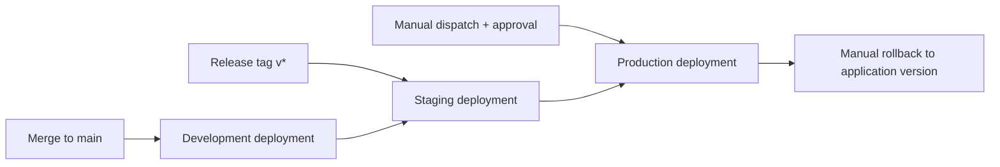

# Plotihub Environment Promotion

This repository defines `dev`, `staging`, and `prod` Terraform configurations with separate S3 state keys.

## Promotion flow



## Triggers

- Push to `main`: deploys `dev`.
- Tag matching `v*`: deploys `staging`.
- Manual workflow dispatch: selects `dev`, `staging`, or `prod`.
- Production deployments require the GitHub Environment named `prod` with required reviewers configured.

The workflow validates Terraform. It does not run Terraform apply. Environment infrastructure should be promoted only after an approved, separately reviewed plan.

## LocalStack state

Remote state uses the same state bucket with independent keys:

- `dev/terraform.tfstate`
- `staging/terraform.tfstate`
- `prod/terraform.tfstate`

## State bootstrap

Create the state bucket and environment deployment buckets before initializing Terraform:

```powershell
.\scripts\start-localstack.ps1
```
